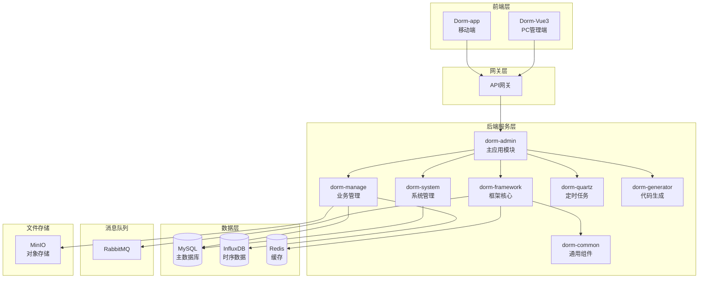
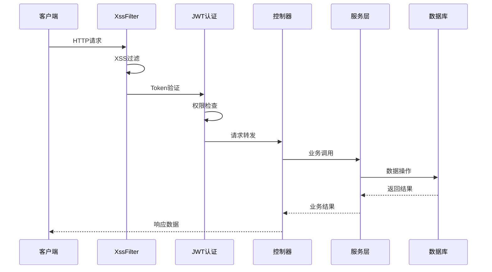

# 学生宿舍管理系统 - 项目架构Wiki

## 📋 目录

1. [项目概述](#项目概述)
2. [系统架构](#系统架构)
3. [技术栈](#技术栈)
4. [模块结构](#模块结构)
5. [核心功能](#核心功能)
6. [数据库设计](#数据库设计)
7. [安全机制](#安全机制)
8. [API接口](#api接口)
9. [开发环境](#开发环境)
10. [部署运行](#部署运行)

---

## 📖 项目概述

**学生宿舍管理系统** 是一套基于 **若依RuoYi v3.8.9** 框架开发的全栈智慧宿舍管理平台，采用前后端分离架构，支持PC端管理、移动端应用等多终端访问。

### 核心特性
- 🏠 **宿舍管理**：楼栋、房间、学生信息统一管理
- 🔧 **维修申请**：在线报修、智能派单、流程跟踪
- 📋 **请假管理**：学生请假申请、审批流程
- 📢 **通知公告**：系统消息发布、互动点赞
- 🚨 **智能报警**：烟雾监控、实时报警、邮件通知
- 👥 **用户权限**：角色权限管理、数据权限控制
- 📊 **监控统计**：系统监控、数据分析、报表展示

---

## 🏗️ 系统架构

### 整体架构图



### 架构特点

1. **前后端分离**：Vue3 + Spring Boot，独立开发部署
2. **模块化设计**：业务模块解耦，便于维护扩展
3. **多端支持**：PC管理端 + 移动端，满足不同场景需求
4. **微服务友好**：模块划分清晰，易于向微服务演进
5. **高可用设计**：Redis缓存、消息队列、负载均衡支持

---

## 💻 技术栈

### 后端技术栈

| 技术 | 版本 | 说明 |
|------|------|------|
| **Spring Boot** | 2.5.15 | 核心框架 |
| **Spring Security** | 5.7.12 | 安全框架 |
| **MyBatis Plus** | - | ORM框架 |
| **MySQL** | 8.0+ | 关系型数据库 |
| **InfluxDB** | 2.x | 时序数据库（烟雾监控） |
| **Redis** | 6.0+ | 缓存数据库 |
| **RabbitMQ** | 3.x | 消息队列 |
| **JWT** | 0.9.1 | 身份认证 |
| **Druid** | 1.2.23 | 数据库连接池 |
| **Quartz** | - | 定时任务 |
| **FastJSON2** | 2.0.57 | JSON处理 |
| **POI** | 4.1.2 | Excel处理 |
| **Swagger3** | 3.0.0 | API文档 |

### 前端技术栈

| 技术 | 版本 | 说明 |
|------|------|------|
| **Vue** | 3.4.31 | 前端框架 |
| **Element Plus** | 2.7.6 | UI组件库 |
| **Vite** | 5.3.2 | 构建工具 |
| **Pinia** | 2.1.7 | 状态管理 |
| **Vue Router** | 4.4.0 | 路由管理 |
| **Axios** | 0.28.1 | HTTP客户端 |
| **ECharts** | 5.5.1 | 图表库 |
| **Splitpanes** | 3.1.5 | 布局组件 |

### 移动端技术栈

| 技术 | 版本 | 说明 |
|------|------|------|
| **uni-app** | 3.0+ | 跨平台框架 |
| **Vue3** | 3.4.21 | 前端框架 |
| **uview-plus** | 3.3.68 | UI组件库 |
| **Pinia** | 2.1.7 | 状态管理 |

---

## 📁 模块结构

### 后端模块详解

```
Dorm/
├── dorm-admin/          # 🚀 主应用模块
│   ├── src/main/java/com/dorm/
│   │   ├── web/controller/     # 控制器层
│   │   ├── RuoYiApplication   # 启动类
│   │   └── config/            # 配置类
│   └── src/main/resources/
│       ├── application.yml    # 主配置文件
│       ├── mapper/           # SQL映射文件
│       └── static/           # 静态资源
│
├── dorm-common/         # 🔧 通用组件模块
│   ├── annotation/      # 注解定义
│   ├── config/         # 通用配置
│   ├── constant/       # 常量定义
│   ├── core/          # 核心组件
│   ├── enums/         # 枚举类
│   ├── exception/     # 异常处理
│   ├── filter/        # 过滤器
│   ├── service/       # 通用服务
│   ├── utils/         # 工具类
│   └── xss/           # XSS防护
│
├── dorm-framework/      # 🏗️ 框架核心模块
│   ├── config/         # 框架配置
│   ├── security/       # 安全配置
│   ├── web/           # Web层配置
│   └── aspectj/       # AOP切面
│
├── dorm-system/        # ⚙️ 系统管理模块
│   ├── domain/        # 系统实体类
│   ├── mapper/        # 系统数据访问
│   ├── service/       # 系统业务服务
│   └── controller/    # 系统控制器
│
├── dorm-manage/        # 🏠 业务管理模块
│   ├── domain/        # 业务实体类
│   ├── mapper/        # 业务数据访问
│   ├── service/       # 业务服务层
│   └── controller/    # 业务控制器
│
├── dorm-quartz/        # ⏰ 定时任务模块
│   ├── domain/        # 任务实体
│   ├── mapper/        # 任务数据访问
│   ├── service/       # 任务服务
│   └── util/          # 任务工具
│
└── dorm-generator/     # 🛠️ 代码生成模块
    ├── domain/        # 生成器实体
    ├── mapper/        # 生成器数据访问
    ├── service/       # 生成器服务
    └── util/          # 生成器工具
```

### 前端模块详解

```
Dorm-Vue3/
├── src/
│   ├── api/               # 🌐 API接口封装
│   │   ├── dorm/         # 宿舍相关API
│   │   ├── manage/       # 业务管理API
│   │   ├── system/       # 系统管理API
│   │   └── login.js      # 登录API
│   │
│   ├── components/        # 🧩 可复用组件
│   │   ├── Pagination/   # 分页组件
│   │   ├── RightToolbar/ # 工具栏组件
│   │   ├── DictTag/      # 字典标签
│   │   └── ...           # 其他组件
│   │
│   ├── directive/         # 📝 自定义指令
│   │   ├── permission/   # 权限指令
│   │   └── common/       # 通用指令
│   │
│   ├── layout/           # 🎨 布局组件
│   │   ├── components/   # 布局子组件
│   │   └── index.vue     # 主布局
│   │
│   ├── router/           # 🛣️ 路由配置
│   │   └── index.js      # 路由定义
│   │
│   ├── store/            # 🗄️ 状态管理
│   │   ├── modules/      # 状态模块
│   │   └── index.js      # 状态入口
│   │
│   ├── utils/            # 🔨 工具函数
│   │   ├── request.js    # HTTP请求封装
│   │   ├── auth.js       # 认证工具
│   │   └── ...           # 其他工具
│   │
│   ├── views/            # 📄 页面组件
│   │   ├── dashboard/    # 仪表盘
│   │   ├── dorm/         # 宿舍管理
│   │   ├── manage/       # 业务管理
│   │   ├── system/       # 系统管理
│   │   └── ...           # 其他页面
│   │
│   ├── App.vue           # 根组件
│   ├── main.js           # 入口文件
│   └── permission.js     # 权限控制
│
├── vite/                 # ⚡ Vite配置
├── package.json          # 依赖配置
└── vite.config.js        # Vite配置文件
```

---

## 🎯 核心功能

### 1. 宿舍管理
- **楼栋管理**：楼栋信息维护、层级结构管理
- **房间管理**：房间分配、状态跟踪、容量管理
- **学生管理**：学生信息维护、入住管理、调宿管理

### 2. 维修管理
- **维修申请**：在线报修、图片上传、问题描述
- **智能派单**：自动派工、工单跟踪、处理反馈
- **流程管理**：申请→派单→处理→完成→评价

### 3. 请假管理
- **请假申请**：请假申请提交、审批流程
- **状态跟踪**：申请状态实时跟踪、审批记录
- **统计分析**：请假统计、时长分析

### 4. 通知公告
- **消息发布**：公告发布、通知推送
- **互动功能**：点赞、评论、阅读统计
- **权限控制**：分级发布、精准推送

### 5. 智能监控
- **烟雾监控**：实时监测、阈值报警
- **设备管理**：设备状态、在线监控
- **数据分析**：趋势分析、历史数据

### 6. 系统管理
- **用户管理**：用户信息、角色分配
- **权限管理**：菜单权限、数据权限
- **日志审计**：操作日志、登录日志
- **参数配置**：系统参数、字典管理

---

## 🗄️ 数据库设计

### 核心业务表

#### 宿舍管理相关
```sql
-- 宿舍楼栋表
dorm_building
- dorm_id (主键)
- dorm_name (宿舍名称)
- full_name (完整名称)
- floor_count (楼层数)
- room_count (房间数)

-- 学生信息表
dorm_student
- student_id (主键)
- student_name (学生姓名)
- student_no (学号)
- class_name (班级)
- dorm_id (宿舍ID)
- phone (联系电话)
```

#### 维修管理相关
```sql
-- 维修申请表
dorm_repair_request
- request_id (主键)
- student_id (申请人)
- dorm_id (宿舍ID)
- repair_type (维修类型)
- description (问题描述)
- images (图片附件)
- status (申请状态)
- request_time (申请时间)

-- 维修派单表
dorm_repair_dispatch
- dispatch_id (主键)
- request_id (申请ID)
- maintainer_id (维修工ID)
- dispatch_time (派单时间)
- expected_time (预期完成时间)
- status (派单状态)
```

#### 告警管理相关
```sql
-- 报警日志表
dorm_alarm_log
- alarm_id (主键)
- device_id (设备ID)
- dorm_id (宿舍ID)
- smoke_value (烟雾值)
- alarm_level (报警级别)
- alarm_time (报警时间)
- handle_status (处理状态)
```

### 系统管理表

#### 用户权限相关
```sql
-- 用户表
sys_user
- user_id (主键)
- user_name (用户名)
- nick_name (昵称)
- email (邮箱)
- phone (手机号)
- sex (性别)
- status (状态)

-- 角色表
sys_role
- role_id (主键)
- role_name (角色名称)
- role_key (角色权限字符串)
- role_sort (显示顺序)
- status (角色状态)

-- 菜单表
sys_menu
- menu_id (主键)
- menu_name (菜单名称)
- parent_id (父菜单ID)
- order_num (显示顺序)
- path (路由地址)
- component (组件路径)
- menu_type (菜单类型)
- perms (权限标识)
```

---

## 🔒 安全机制

### 1. 认证授权
- **JWT无状态认证**：Token生成、验证、刷新
- **角色权限控制**：基于RBAC的权限模型
- **数据权限过滤**：按部门、用户等维度过滤数据

### 2. 安全防护
- **XSS防护**：输入过滤、输出转义
- **SQL注入防护**：参数化查询、预编译
- **CSRF防护**：Token验证、同源检查
- **敏感数据脱敏**：密码、手机号等敏感字段处理

### 3. 审计监控
- **操作日志**：用户操作记录、异常监控
- **登录日志**：登录记录、异常登录检测
- **系统监控**：性能监控、资源使用情况

### 安全架构流程



---

## 🔌 API接口

### 接口规范

#### 请求格式
```json
{
  "url": "/api/dorm/repair/list",
  "method": "GET",
  "headers": {
    "Authorization": "Bearer {token}",
    "Content-Type": "application/json"
  },
  "params": {
    "pageNum": 1,
    "pageSize": 10,
    "status": "1"
  }
}
```

#### 响应格式
```json
{
  "code": 200,
  "msg": "操作成功",
  "data": {
    "total": 100,
    "rows": [
      {
        "requestId": 1,
        "studentName": "张三",
        "dormName": "A101",
        "repairType": "水电维修",
        "status": "1",
        "requestTime": "2024-01-01 10:00:00"
      }
    ]
  }
}
```

### 主要接口模块

#### 1. 宿舍管理API
```
GET    /dorm/building/list        # 获取楼栋列表
POST   /dorm/building             # 新增楼栋
PUT    /dorm/building             # 修改楼栋
DELETE /dorm/building/{id}        # 删除楼栋

GET    /dorm/student/list         # 获取学生列表
POST   /dorm/student              # 新增学生
PUT    /dorm/student              # 修改学生信息
DELETE /dorm/student/{id}         # 删除学生
```

#### 2. 维修管理API
```
GET    /manage/repair/list        # 获取维修申请列表
POST   /manage/repair             # 提交维修申请
PUT    /manage/repair/{id}        # 更新申请状态
GET    /manage/repair/{id}        # 获取申请详情

POST   /manage/dispatch           # 创建派单
PUT    /manage/dispatch/{id}      # 更新派单状态
GET    /manage/dispatch/list      # 获取派单列表
```

#### 3. 告警管理API
```
GET    /manage/alarm/list         # 获取报警列表
POST   /manage/alarm              # 新增报警记录
PUT    /manage/alarm/{id}         # 处理报警
GET    /manage/alarm/statistics   # 报警统计
```

#### 4. 系统管理API
```
GET    /system/user/list          # 获取用户列表
POST   /system/user               # 新增用户
PUT    /system/user               # 修改用户
DELETE /system/user/{id}          # 删除用户

GET    /system/role/list          # 获取角色列表
POST   /system/role               # 新增角色
PUT    /system/role               # 修改角色
DELETE /system/role/{id}          # 删除角色
```

---

## 🛠️ 开发环境

### 环境要求

#### 后端环境
- **JDK**: 1.8+
- **Maven**: 3.6+
- **MySQL**: 8.0+
- **Redis**: 6.0+
- **InfluxDB**: 2.0+ (可选)
- **RabbitMQ**: 3.8+ (可选)

#### 前端环境
- **Node.js**: 16+
- **npm/yarn**: 最新版本

### 开发工具推荐
- **后端IDE**: IntelliJ IDEA / Eclipse
- **前端IDE**: VS Code / WebStorm
- **数据库工具**: Navicat / DBeaver
- **API测试**: Postman / Apifox
- **版本控制**: Git

### 本地开发配置

#### 1. 后端配置
```yaml
# application-dev.yml
server:
  port: 8080

spring:
  datasource:
    url: jdbc:mysql://localhost:3306/dorm_db?useUnicode=true&characterEncoding=utf8&zeroDateTimeBehavior=convertToNull&useSSL=true&serverTimezone=GMT%2B8
    username: root
    password: password
    
  redis:
    host: localhost
    port: 6379
    password: 
    
  mail:
    host: smtp.qq.com
    port: 587
    username: your-email@qq.com
    password: your-auth-code
```

#### 2. 前端配置
```javascript
// vite.config.js
export default defineConfig({
  server: {
    port: 80,
    proxy: {
      '/dev-api': {
        target: 'http://localhost:8080',
        changeOrigin: true,
        rewrite: (path) => path.replace(/^\/dev-api/, '')
      }
    }
  }
})
```

---

## 🚀 部署运行

### 本地运行

#### 1. 后端运行
```bash
# 进入后端目录
cd Dorm

# 编译打包
mvn clean package

# 运行应用
java -jar dorm-admin/target/dorm-admin-3.8.9.jar

# 或使用脚本运行
./ry.sh start
```

#### 2. 前端运行
```bash
# 进入前端目录
cd Dorm-Vue3

# 安装依赖
yarn install

# 启动开发服务
yarn dev

# 构建生产版本
yarn build:prod
```

#### 3. 移动端运行
```bash
# 进入移动端目录
cd Dorm-app

# 安装依赖
yarn install

# 启动H5开发
yarn dev:h5

# 构建H5版本
yarn build:h5
```

### 生产部署

#### 1. 服务器配置
```bash
# 系统要求
- CPU: 2核心+
- 内存: 4GB+
- 存储: 50GB+
- 操作系统: CentOS 7+ / Ubuntu 18+

# 环境安装
sudo yum install -y java-1.8.0-openjdk
sudo yum install -y mysql-server redis nginx
```

#### 2. 数据库初始化
```sql
-- 创建数据库
CREATE DATABASE dorm_db CHARACTER SET utf8mb4 COLLATE utf8mb4_general_ci;

-- 导入表结构和数据
mysql -u root -p dorm_db < sql/ry-vue-09-07.sql
```

#### 3. 应用部署
```bash
# 后端部署
nohup java -jar dorm-admin-3.8.9.jar --spring.profiles.active=prod > logs/app.log 2>&1 &

# 前端部署 (Nginx配置)
server {
    listen 80;
    server_name your-domain.com;
    root /var/www/dorm-vue3/dist;
    
    location / {
        try_files $uri $uri/ /index.html;
    }
    
    location /prod-api/ {
        proxy_pass http://localhost:8080/;
        proxy_set_header Host $host;
        proxy_set_header X-Real-IP $remote_addr;
    }
}
```

### 监控运维

#### 1. 应用监控
- **Spring Boot Actuator**: 健康检查、指标监控
- **日志监控**: Logback日志收集分析
- **数据库监控**: Druid连接池监控

#### 2. 系统监控
- **服务器监控**: CPU、内存、磁盘使用率
- **网络监控**: 带宽使用、连接数统计
- **告警通知**: 异常状况自动通知

---

## 📚 开发规范

### 代码规范
- **Java**: 阿里巴巴Java开发手册
- **Vue**: Vue官方风格指南
- **数据库**: 统一命名规范、索引优化

### 提交规范
```bash
# Git提交格式
feat: 新增功能
fix: 修复问题
docs: 文档更新
style: 代码格式
refactor: 代码重构
test: 测试相关
chore: 构建过程或辅助工具的变动
```

### 分支管理
```
main (master)     # 主分支，生产环境
develop           # 开发分支
feature/*         # 功能分支
hotfix/*          # 热修复分支
release/*         # 发布分支
```

---

## 🔗 相关链接

- **RuoYi官网**: http://ruoyi.vip
- **Vue3文档**: https://cn.vuejs.org
- **Element Plus**: https://element-plus.org
- **Spring Boot**: https://spring.io/projects/spring-boot
- **uni-app**: https://uniapp.dcloud.net.cn

---

## 📞 技术支持

如有问题，请通过以下方式联系：
- **开发团队**: development@dorm.com
- **技术支持**: support@dorm.com
- **项目地址**: https://github.com/your-org/dorm-system

---

*本文档最后更新时间: 2024-09-08*
*文档版本: v1.0.0*